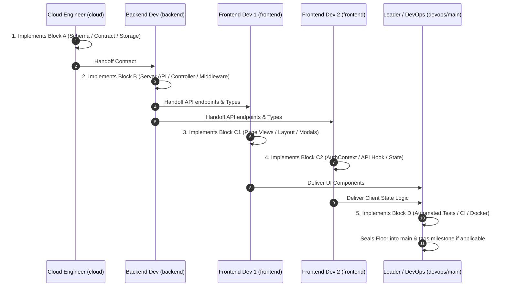

# Team Workflow & Git Branching Strategy

This document defines the development workflow, branch governance, and daily commit standards for the 5-member engineering team building the **Smart Recruitment & Applicant Tracking System (ATS)**.

---

## 1. Team Roster & Role Specialization

| Member Role | Primary Responsibility | Persistent Branch | Daily Block in Handoff Chain |
| :--- | :--- | :--- | :--- |
| **Leader / DevOps Engineer** | Monorepo structure, Docker orchestration, CI/CD pipeline, Jest/Playwright test suites, daily floor seal into `main` | `devops` / `main` | **Block D** (Floor Seal) |
| **Cloud Engineer** | Firebase Auth emulator, Custom Claims synchronization, PostgreSQL parameter tuning, private storage streaming, SMTP configuration | `cloud` | **Block A** (Contract Lead) |
| **Backend Developer** | 12-table SQL migrations, Express REST API endpoints, JWT/RBAC guards, pipeline state machine, and SQL analytics engine | `backend` | **Block B** (API Implementation) |
| **Frontend Developer 1** | Responsive layout shells, navigation, design tokens, page views, modals, forms, and accessibility polish | `frontend` | **Block C1** (UI & Layouts) |
| **Frontend Developer 2** | Client-side Firebase SDK, Axios JWT interceptors, AuthContext, custom API hooks, and client-side form validation | `frontend` | **Block C2** (State & Auth) |

---

## 2. The 5 Persistent Branches

```text
main (Integrated, stable releases, protected)
 ├── devops    (Leader & DevOps changes, test runners, Docker, CI/CD)
 ├── frontend  (Frontend Developer 1 & 2 integration branch)
 ├── backend   (Backend Developer API & database migrations)
 └── cloud     (Cloud Engineer Firebase, storage, and infrastructure)
```

1. **`main`**:
   - Represents the verified, working application state.
   - At the end of each day (Floor N), the Leader / DevOps Engineer merges the floor's validated code into `main`.
   - Never push directly to `main`.
2. **`devops`**:
   - Branch for testing scripts, Dockerfiles, GitHub Actions workflows, and quality gates.
3. **`frontend`**:
   - Shared staging branch for both frontend developers.
   - Merges UI layout work and API state wiring before handoff to DevOps for floor sealing.
4. **`backend`**:
   - Contains all database migrations, API routes, controllers, middleware, and business logic.
5. **`cloud`**:
   - Contains Firebase configs, emulator configs, storage services, and cloud deployment pipelines.

---

## 3. Daily 5-Commit Execution Protocol (Floors 1 to 25)

Every day corresponds to one "Floor" of the development pyramid. Each floor consists of 5 coordinated commits, committed in a logical sequence to prevent blocking:



### Daily Handoff Order
1. **Morning — Block A (Cloud Engineer):**
   - Implements the contract, environment parameters, storage paths, or auth configs.
   - Commits to `cloud` (or feature branch `floor-NN/cloud-...`).
2. **Midday — Block B (Backend Developer):**
   - Pulls updates, implements the DDL migration or Express API route matching the contract.
   - Commits to `backend` (or feature branch `floor-NN/backend-...`).
3. **Afternoon — Block C1 & C2 (Frontend Developers):**
   - **Frontend Developer 1:** Builds the corresponding screen layout, form modal, or visual components.
   - **Frontend Developer 2:** Connects the API client, manages local/global state, and wires form validation.
   - Both commit to their respective feature branches, test locally, and merge into `frontend`.
4. **Evening — Block D (Leader & DevOps Engineer):**
   - Merges the role branches, executes automated Supertest / Playwright suites, verifies no regression, and merges into `main` to seal the floor.

---

## 4. Feature Branch Naming Rules

For short-lived work within a floor:
* Format: `floor-<DayNumber>/<role>-<topic>`
* Examples:
  * `floor-01/devops-monorepo-init`
  * `floor-02/cloud-postgres-config`
  * `floor-03/backend-jobs-schema`
  * `floor-04/frontend-login-ui`
  * `floor-05/frontend-auth-context`

---

## 5. Commit Message Convention

All commits must follow Conventional Commits formatting:

* `feat(scope): message` — New features or endpoints
* `fix(scope): message` — Bug fixes
* `test(scope): message` — Unit, integration, or E2E tests
* `ci(scope): message` — CI/CD, Docker, or GitHub Actions
* `docs(scope): message` — Documentation, specs, or checklists
* `chore(scope): message` — Maintenance or config

---

## 6. Security & PII Hygiene

1. **Zero Secrets in Git:** Never commit `.env`, service account JSON files, or database credentials.
2. **No Real PII:** All resumes uploaded for testing must be synthetic sample PDFs stored in `uploads/` (which is git-ignored).
3. **Verification Before Push:** Run `git status` before every commit to ensure no unintended files or secrets are staged.
