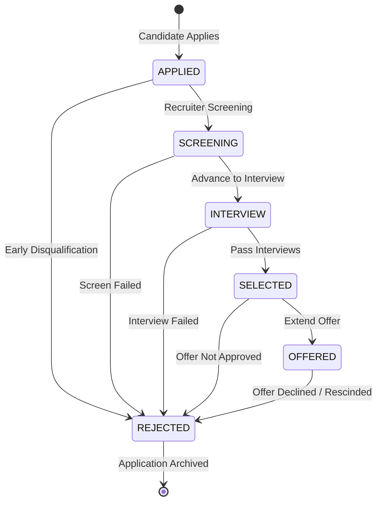
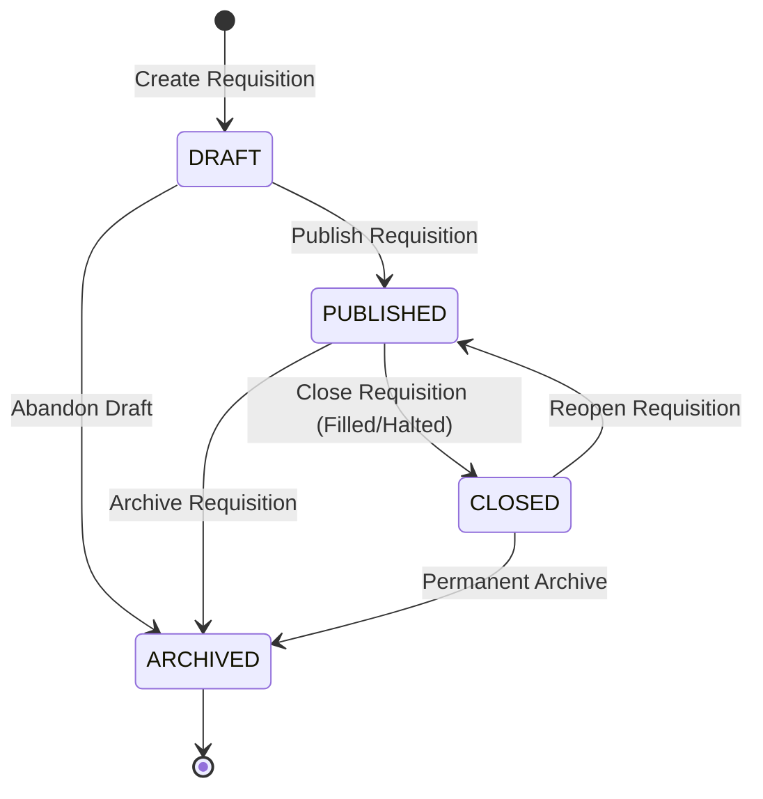

# Recruitment Pipeline & Job Requisition Status Transitions Specification

**Smart Recruitment & Applicant Tracking System (ATS)**  
**Specification Version:** `1.0.0` (Tier 2 / Floor 14 Milestone)  
**Author:** Backend Architecture Team (Raheema)  
**Last Updated:** Week 2 / Day 14

---

## 1. Executive Summary

This document formalizes the finite state machines (FSM) governing **Application Stages** and **Job Requisition Lifecycles** across the Smart Recruitment & Applicant Tracking System. 

All state transitions are enforced server-side using ACID PostgreSQL database transactions, strict validation services (`stageMachine.ts`), row-level locking (`SELECT ... FOR UPDATE`), and tamper-evident audit logging (`application_stage_history`).

---

## 2. Application Pipeline State Machine

### 2.1 State Definitions

| Stage | Description | Terminal? | Allowed Next Stages |
| :--- | :--- | :--- | :--- |
| **`APPLIED`** | Initial submission by candidate or external ingestion. | No | `SCREENING`, `REJECTED` |
| **`SCREENING`** | Resume screening, qualifications vetting, and recruiter review. | No | `INTERVIEW`, `REJECTED` |
| **`INTERVIEW`** | Technical, behavioral, or cultural interviews scheduled or conducted. | No | `SELECTED`, `REJECTED` |
| **`SELECTED`** | Candidate cleared all interviews; selected for potential hiring. | No | `OFFERED`, `REJECTED` |
| **`OFFERED`** | Formal employment offer extended to the candidate. | No | `REJECTED` (candidate declines or offer rescinded) |
| **`REJECTED`** | Application closed. The candidate did not advance or withdrew. | **Yes** | *None* (Immutable terminal stage) |

---

### 2.2 Transition Diagram



---

### 2.3 Strict Transition Rules & Invariants

1. **Sequential Advancement:** Applications must advance linearly through the pipeline stages:
   $$\text{APPLIED} \longrightarrow \text{SCREENING} \longrightarrow \text{INTERVIEW} \longrightarrow \text{SELECTED} \longrightarrow \text{OFFERED}$$
2. **Strict Stage-Skipping Prohibition:** Bypassing intermediate stages (e.g., advancing directly from `APPLIED` to `INTERVIEW` or `OFFERED`) is strictly rejected with HTTP `422 Unprocessable Entity` or `400 Bad Request`.
3. **Omnipresent Disqualification:** An application in any non-terminal stage (`APPLIED`, `SCREENING`, `INTERVIEW`, `SELECTED`, `OFFERED`) may transition directly to `REJECTED`.
4. **Terminal State Immutability:** Once an application enters `REJECTED`, no further transitions are permitted under any circumstances. Any attempt to transition an application out of `REJECTED` results in `400 Bad Request`.
5. **No Redundant Self-Transitions:** Transitioning an application to its current stage (e.g., `SCREENING` $\to$ `SCREENING`) is prohibited and returns `400 Bad Request`.
6. **Mandatory Justification Reason:** Every stage transition requires an explanatory note (`reason`) of at least 3 characters justifying the recruitment decision. Empty or whitespace-only reasons are rejected.
7. **Concurrency & Atomicity:** All stage transitions acquire a pessimistic row lock (`SELECT ... FOR UPDATE OF a`) on the application row to guarantee race-free serialization under concurrent access.

---

### 2.4 Transition Matrix

| From Stage \ To Stage | `APPLIED` | `SCREENING` | `INTERVIEW` | `SELECTED` | `OFFERED` | `REJECTED` |
| :--- | :---: | :---: | :---: | :---: | :---: | :---: |
| **`APPLIED`** | ❌ (Identical) | ✅ Allowed | ❌ (Skip) | ❌ (Skip) | ❌ (Skip) | ✅ Allowed |
| **`SCREENING`** | ❌ (Backward) | ❌ (Identical) | ✅ Allowed | ❌ (Skip) | ❌ (Skip) | ✅ Allowed |
| **`INTERVIEW`** | ❌ (Backward) | ❌ (Backward) | ❌ (Identical) | ✅ Allowed | ❌ (Skip) | ✅ Allowed |
| **`SELECTED`** | ❌ (Backward) | ❌ (Backward) | ❌ (Backward) | ❌ (Identical) | ✅ Allowed | ✅ Allowed |
| **`OFFERED`** | ❌ (Backward) | ❌ (Backward) | ❌ (Backward) | ❌ (Backward) | ❌ (Identical) | ✅ Allowed |
| **`REJECTED`** | ❌ (Terminal) | ❌ (Terminal) | ❌ (Terminal) | ❌ (Terminal) | ❌ (Terminal) | ❌ (Terminal) |

---

## 3. Job Requisition Lifecycle

### 3.1 Status Definitions

| Status | Description | Visibility | Modifiable? |
| :--- | :--- | :--- | :--- |
| **`DRAFT`** | Initial creation by HR/Admin. Not visible to candidates. | Internal HR & Admin only | Yes |
| **`PUBLISHED`** | Active public requisition accepting candidate applications. | Public Candidate Portal | Yes |
| **`CLOSED`** | Requisition filled or on hold; no new applications accepted. | Public (marked closed) / HR | Yes (can reopen to `PUBLISHED`) |
| **`ARCHIVED`** | Requisition deprecated and kept for historical reporting. | Admin & HR only | Read-only |

---

### 3.2 Job Lifecycle Transition Diagram



### 3.3 Timestamp Lifecycle Rules

- When transitioning to **`PUBLISHED`**:
  - `published_at` is set to the current timestamp ($NOW()$) if previously `NULL`.
  - `closed_at` is reset to `NULL` (supporting clean reopening cycles).
- When transitioning to **`CLOSED`**:
  - `closed_at` is set to current timestamp ($NOW()$) if previously `NULL`.
- When transitioning to **`ARCHIVED`**:
  - Application submissions are permanently blocked.

---

## 4. API Error Codes and HTTP Status Mapping

The application enforces standard JSON error responses:

```json
{
  "success": false,
  "error": {
    "message": "Human-readable error description",
    "statusCode": 400,
    "details": []
  }
}
```

### 4.1 Error Mapping Table

| HTTP Status | Error Scenario | Example Trigger |
| :--- | :--- | :--- |
| **`400 Bad Request`** | Invalid UUID format | `PATCH /api/applications/not-a-uuid/stage` |
| **`400 Bad Request`** | Self-transition | Transitioning from `SCREENING` to `SCREENING` |
| **`400 Bad Request`** | Terminal stage mutation | Attempting to move application out of `REJECTED` |
| **`400 Bad Request`** | Missing or short reason | Transition reason shorter than 3 characters |
| **`401 Unauthorized`** | Missing or invalid auth token | Missing Bearer token in `Authorization` header |
| **`403 Forbidden`** | Role authorization violation | `CANDIDATE` role calling `PATCH /api/applications/:id/stage` |
| **`403 Forbidden`** | Multi-tenant company boundary | HR user attempting to change stage in another company's job |
| **`404 Not Found`** | Resource does not exist | Application or Job ID not found in database |
| **`422 Unprocessable Entity`** | Invalid state machine transition | Attempting illegal stage skip: `APPLIED` $\to$ `OFFERED` |
| **`409 Conflict`** | Concurrency conflict / Deadlock | Simultaneous conflicting updates handled by lock serialization |

---

## 5. Audit Logging Invariants

Every successful transition creates an immutable record in `application_stage_history`:

1. `application_id`: Target application UUID.
2. `from_stage`: Previous verified stage.
3. `to_stage`: New verified stage.
4. `changed_by`: Firebase UID of the authenticated HR or Admin user who performed the transition.
5. `reason`: Mandatory justification note provided by the actor.
6. `changed_at`: Server-generated timestamp ($NOW()$).

The audit timeline is accessible via `GET /api/applications/:id/history` and displayed within the **Candidate Dossier Drawer** for compliance.
